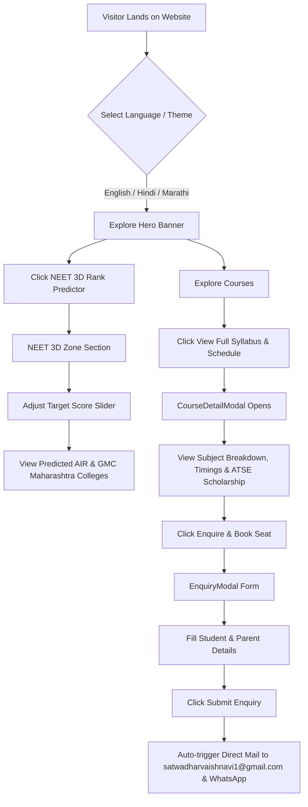

# 🎓 Awad Educational Academy (AEA), Kaij
> **Learn • Practice • Improve • Achieve**  
> *Official Web Application & 3D NEET Medical Aspirants Platform*

[](https://reactjs.org/)
[](https://www.typescriptlang.org/)
[](https://vitejs.dev/)
[](https://tailwindcss.com/)
[](#)

---

## 📌 Executive Summary

**Awad Educational Academy (AEA)**, located in Kaij, Beed, Maharashtra under the leadership of **Director Dr. Vithal Awad**, is a premier academic coaching institute specializing in **NEET UG Medical Entrance Preparation (Class XI, XII & Droppers)**, **School Academic Coaching (Classes V - IX)**, **Foundation Programs (Classes VII - X)**, **SOF Olympiads**, and **State / CBSE Board Milestone Exams**.

This web platform provides a **3D interactive experience** for students and parents featuring an All India Rank (AIR) estimator, NCERT daily quizzes, detailed syllabus explorer modals, and direct admission enquiry workflows.

---

## 🚀 Key Platform Features

### 🩺 1. NEET 3D Zone (`NeetHubSection.tsx`)
* **Awad Logo Background Watermark**: Glowing, semi-transparent background watermark of the official Awad Educational Academy logo.
* **NEET 2026 Rank & GMC Domicile Predictor**: Score slider ($300 - 720$) & category selector (`OPEN`, `OBC`, `EWS`, `SC`, `ST`) predicting eligible Government Medical Colleges in Maharashtra (*GMC Mumbai, B.J. Medical College Pune, GMC Sambhajinagar, SRT GMC Ambajogai, GMC Latur, GMC Nanded*).
* **Daily NCERT NEET Quiz Challenge**: Interactive practice MCQs for Botany, Zoology, Physics, and Chemistry with line-by-line NCERT explanations.

### 📚 2. Interactive Course Explorer (`CourseDetailModal.tsx`)
* Deep-dive course modal with 4 interactive tabs:
  1. **NCERT Syllabus**: Subject-wise topics & weekly lecture hours.
  2. **Class Timings & Tests**: Weekly schedule (6 days/week), morning/afternoon batches, Sunday OMR mock tests, and daily doubt desk.
  3. **Key Features & Faculty**: Mentorship benefits, 30-student small batch guarantee, and weekly report cards.
  4. **ATSE Scholarship & Fees**: Awad Talent Search Examination (ATSE) scholarship waivers (up to 100%) and 3-part flexible installment options.

### 🖼️ 3. Dynamic 3D Hero Slider (`Hero.tsx`)
* Auto-playing 3-second header image carousel showcasing classroom environments, practical labs, and toppers, equipped with progress timer animation and pause/play controls.

### 📜 4. Horizontal Scroll Testimonials (`Testimonials.tsx`)
* Smooth horizontal scrolling reviews track with left (`←`) and right (`→`) navigation controls.
* Built-in `WriteReviewModal` enabling students and parents to submit verified reviews directly stored in local storage.

### 📧 5. Direct Mail & WhatsApp Integration
* All admission forms and enquiries trigger direct emails to **`satwadharvaishnavi1@gmail.com`** and WhatsApp messages to **`+91 94221 05262`**.

### 🌐 6. Multilingual i18n Support
* Complete internationalization in **English (🇬🇧)**, **Hindi (🇮🇳 - हिंदी)**, and **Marathi (🇮🇳 - मराठी)**.

---

## 🎨 Page Wireframe (WF) & Layout Architecture

```
+-----------------------------------------------------------------------------------+
|                            TOP ANNOUNCEMENT BAR                                   |
| Admissions Open 2026-27 | Kaij, Beed, Maharashtra | Call: +91 94221 05262            |
+-----------------------------------------------------------------------------------+
|                            STICKY NAVIGATION BAR                                  |
| [Awad Logo] Home  NEET 3D Zone  Courses  About  Why Us  Results  Gallery [Lang]   |
+-----------------------------------------------------------------------------------+
|                                 HERO SECTION                                      |
|  [Headlines & 3D CTAs]                   [Dynamic 3-Sec Image Carousel Slider]    |
|  - NEET 3D Rank Predictor                - Progress Bar Timer                     |
|  - Explore Courses                       - Next/Prev Controls & Pause Indicator   |
+-----------------------------------------------------------------------------------+
|                              NEET 3D ZONE (LIGHT)                                 |
|  [Awad Logo Watermark Background]                                                 |
|  +-------------------------------------+  +------------------------------------+  |
|  |  NEET Score & AIR Rank Predictor    |  |  Daily NCERT NEET Practice Quiz    |  |
|  |  - Interactive 720 Score Slider     |  |  - MCQ Question & 4 Options        |  |
|  |  - GMC Maharashtra College Chips    |  |  - Instant NCERT Explanation       |  |
|  +-------------------------------------+  +------------------------------------+  |
+-----------------------------------------------------------------------------------+
|                            COURSES & BATCHES GRID                                 |
|  [All] [NEET UG Special] [Foundation] [School Academics] [Olympiads] [Boards]     |
|  +-------------------+  +-------------------+  +-------------------+              |
|  | NEET Target 2026  |  | NEET Repeater     |  | Foundation 7th-10|              |
|  | [View Syllabus]   |  | [View Syllabus]   |  | [View Syllabus]   |              |
|  +-------------------+  +-------------------+  +-------------------+              |
+-----------------------------------------------------------------------------------+
|                          ABOUT AWAD ACADEMY & FOUNDER                             |
|  Director & Founder: Dr. Vithal Awad | Core Pillars: Concepts, Attention, Practice|
+-----------------------------------------------------------------------------------+
|                            RESULTS & TOPPERS GRID                                 |
|  [NEET Rankers] [Board Toppers] [Olympiad Medalists]                              |
|  - Verified Result Badges & Score Cards (675/720 GMC Selections)                  |
+-----------------------------------------------------------------------------------+
|                       TESTIMONIALS (HORIZONTAL SCROLL)                            |
|  [←] [→] [Write Review Button]                                                     |
|  [Card 1]  [Card 2]  [Card 3]  [User Review 4]                                   |
+-----------------------------------------------------------------------------------+
|                           GALLERY & CAMPUS LIGHTBOX                               |
|  Classroom Sessions | Olympiad Halls | Honor Ceremonies | Kaij Infrastructure    |
+-----------------------------------------------------------------------------------+
|                          CONTACT & ADMISSION ENQUIRY                              |
|  Address: Main Road, Near Bus Stand, Kaij, Beed | Map Embed                       |
|  Enquiry Form -> Sends Direct Email to satwadharvaishnavi1@gmail.com             |
+-----------------------------------------------------------------------------------+
|                                 FOOTER STRIP                                      |
|  Social Links (YouTube, Facebook, Insta) | Quick Links | Copyright                |
+-----------------------------------------------------------------------------------+
```

---

## 🔄 User Journey & Data Flow (WF Diagram)



---

## 🛠️ Technology Stack

| Layer | Technology Used |
| :--- | :--- |
| **Core Framework** | React 18.2.0 (Functional Components, Hooks) |
| **Language** | TypeScript 5.2.2 (Strict Types, Interfaces) |
| **Build Tool** | Vite 5.1.6 (Fast HMR & ESM Bundling) |
| **Styling** | Tailwind CSS 3.4.1 + Custom 3D CSS Utilities (`index.css`) |
| **Icons** | Lucide React 0.344.0 |
| **State & i18n** | Custom React Context (`LanguageContext.tsx`) |
| **Storage** | Browser `localStorage` for dynamic user reviews |

---

## 📂 Project Directory Structure

```
awad-educational-academy/
├── public/                     # Public assets
├── images/                     # Academy photos, logos & gallery assets
├── src/
│   ├── components/             # UI Components
│   │   ├── About.tsx           # About Dr. Vithal Awad & Academy Pillars
│   │   ├── ContactSection.tsx  # Contact info, Google Maps & Direct Email Form
│   │   ├── CourseDetailModal.tsx # Detailed syllabus & schedule modal
│   │   ├── Courses.tsx         # Courses grid & category filtering
│   │   ├── EnquiryCTA.tsx      # Mid-page banner CTA
│   │   ├── EnquiryModal.tsx    # Pop-up admission enquiry modal
│   │   ├── FloatingWhatsApp.tsx# Sticky WhatsApp call-to-action widget
│   │   ├── Footer.tsx          # Page footer with social media links
│   │   ├── Gallery.tsx         # Classroom & event image gallery
│   │   ├── Hero.tsx            # 3D Hero section with 3-sec slider
│   │   ├── LanguageSelector.tsx# Language switch dropdown
│   │   ├── LearningProcess.tsx # 5-step learning workflow (Learn-Practice-Test)
│   │   ├── Logo.tsx            # Awad Educational Academy logo component
│   │   ├── Navbar.tsx          # Sticky header & mobile drawer navigation
│   │   ├── NeetHubSection.tsx  # 3D NEET Zone, Score Predictor & NCERT Quiz
│   │   ├── ResultsStats.tsx    # Verified toppers & academy stats
│   │   ├── Testimonials.tsx   # Horizontal scrolling reviews
│   │   ├── WhyChooseUs.tsx     # Key academy advantages
│   │   └── WriteReviewModal.tsx# Review submission dialog
│   ├── context/
│   │   └── LanguageContext.tsx # i18n Context Provider
│   ├── data/
│   │   └── academyData.ts      # Main dataset (Courses, Toppers, Contact, Socials)
│   ├── i18n/
│   │   └── translations.ts     # Multilingual translations (EN, HI, MR)
│   ├── App.tsx                 # Main application root
│   ├── index.css               # 3D perspective styles & Tailwind imports
│   └── main.tsx                # Entry point
├── index.html                  # HTML5 Entry file
├── tailwind.config.js          # Tailwind theme & color extension
├── tsconfig.json               # TypeScript compiler config
└── package.json                # Project dependencies & scripts
```

---

## 💻 Installation & Local Development

### Prerequisites
* **Node.js**: v18.0.0 or higher
* **npm**: v9.0.0 or higher

### Steps to Run Locally

1. **Clone or Open the Repository**:
   ```bash
   cd "c:\Users\hp\OneDrive\Visual Studio\vscode\awad academy kaij"
   ```

2. **Install Dependencies**:
   ```bash
   npm install
   ```

3. **Start Development Server**:
   ```bash
   npm run dev
   ```
   Open your browser at `http://localhost:5173`.

4. **Build for Production**:
   ```bash
   npm run build
   ```

5. **Preview Production Build**:
   ```bash
   npm run preview
   ```

---

## 📞 Contact & Official Links

* **Director & Founder**: Dr. Vithal Awad
* **Academy Name**: Awad Educational Academy (AEA), Kaij
* **Location**: Main Road, Near Bus Stand, Kaij, District Beed, Maharashtra - 431123
* **Phone / WhatsApp**: [+91 94221 05262](tel:+919422105262)
* **Direct Email**: [satwadharvaishnavi1@gmail.com](mailto:satwadharvaishnavi1@gmail.com)
* **YouTube Channel**: [Awad Educational Academy YouTube](http://www.youtube.com/@awadeducationalacademyaea5913)
* **Facebook Page**: [Awad Educational Academy Facebook](https://www.facebook.com/awadeducationalacademy/)

---
*Developed with excellence for NEET Medical & Academic Aspirants in Kaij.* 🎓✨
